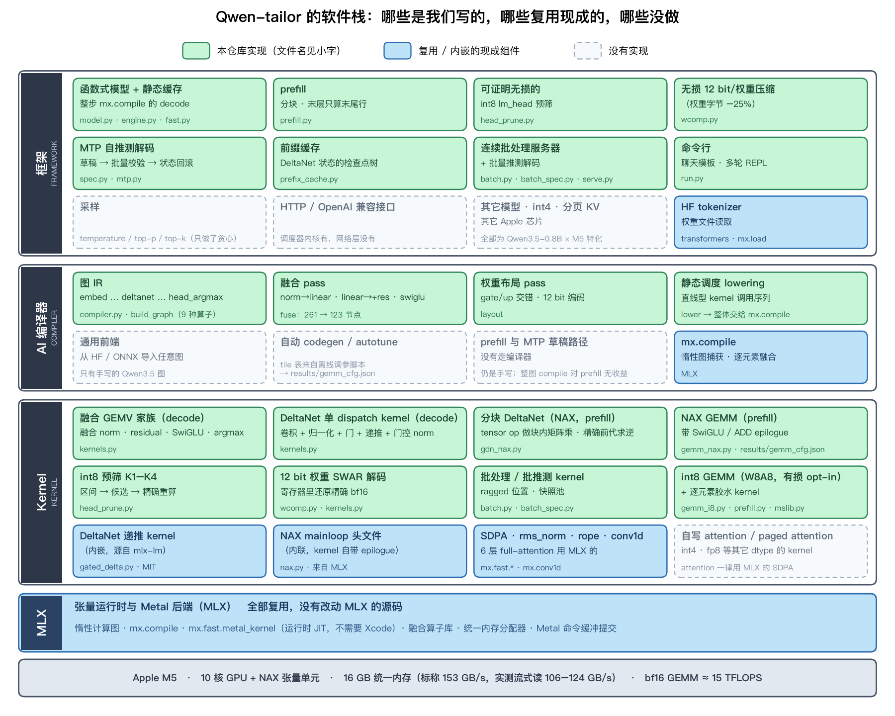

# Qwen-tailor

**一次实验：让 coding agent 为一个具体的模型、一块具体的芯片写出模型特化、性能逼近硬件上限的推理服务。**
目标是 **Qwen3.5-0.8B（bf16，不量化）× Apple M5**，基于 [MLX](https://github.com/ml-explore/mlx)；本仓库是这次实验的全部产物：
手写 Metal kernel、一个只服务于这个模型的小型图编译器、MTP 自推测解码、前缀缓存、连续批处理服务器，以及全部的基准、测试和开发记录。

默认路径与 mlx-lm 的贪心输出**逐 token 一致**，下文标「有损」的选项都是显式 opt-in。



*图 0：软件栈分层。MLX 之上的三层是这次实验里 coding agent 写的部分（绿色），蓝色是直接复用的现成组件，虚线框是明确没有做的。编译器层是旁路原型：只在测试和基准里运行，没有接入 Engine 和服务器，最终成绩全部来自手写路径。每个绿色框的小字是对应的源文件，细节见 [2.2](#22-框架支持的功能--实现的-kernel--编译器的改动)。*

> 目录：[1. 实验目的](#1-实验目的) · [2. 实验过程](#2-实验过程)（[2.1 实验配置](#21-实验配置) · [2.2 框架功能 / kernel / 编译器](#22-框架支持的功能--实现的-kernel--编译器的改动) · [2.3 实验结果](#23-实验结果)）· [3. 观察](#3-观察难度在哪里) · [4. 使用与复现](#4-使用与复现) · [5. 仓库结构](#5-仓库结构) · [6. 局限](#6-局限)

## 1. 实验目的

通用推理框架（mlx-lm、llama.cpp、vLLM……）要服务成百上千种模型，所以对任何单个模型都留有余地。反过来，如果只服务**一个**模型、**一块**芯片，
可以把形状、数据类型、融合方式、调度全部写死，贴着硬件上限走——但这需要同时懂 GPU kernel、编译器和推理系统。

我想验证的是：**让 coding agent 来写一个模型特化、并且性能良好的推理服务，难度到底是什么样的？**

具体来说，这个实验想回答：

1. agent 能不能从原样的 mlx-lm 出发，把性能推到离硬件 roofline 不远的位置（而不是只做出「能跑」的版本）？
2. 这条路上的难点在哪里：写 kernel、做性能归因、保证正确性，还是别的？
3. 哪些东西是 agent 能独立走通的，哪些需要外部的验收标准、测量基础设施或人的判断？

Qwen3.5-0.8B + M5 这个组合的好处是问题有一个**明确可算的天花板**：模型小（每 token 只需读约 1.5 GB 权重），decode 是纯内存带宽受限，
prefill 是纯算力受限，两者的 roofline 都可以实测；同时它是 GatedDeltaNet（线性注意力）与全注意力的混合结构，递推状态让前缀缓存、推测解码都比纯 Transformer 多出需要解决的问题。

## 2. 实验过程

### 2.1 实验配置

**硬件与软件**

| 项 | 配置 |
|---|---|
| 芯片 | Apple M5，10 核 GPU，16 GB 统一内存，标称内存带宽 153 GB/s |
| 系统 | macOS 26.5.1，只装了 Command Line Tools（**没有 Xcode**：没有 `metal` 编译器，也没有 GPU 抓帧 / Instruments） |
| 软件 | Python 3.12，mlx 0.32.4，transformers 5.20.2（只用分词器）；mlx-lm 0.32.2 只作基线和测试参照，不是运行时依赖 |
| 模型 | [Qwen/Qwen3.5-0.8B](https://huggingface.co/Qwen/Qwen3.5-0.8B)，bf16；24 层 = 18 层 GatedDeltaNet（递推状态 fp32 `[16,128,128]`）+ 6 层全注意力（GQA，头维 256）；隐层 1024，词表 248320，输出头与 embedding 绑定；带 1 层 MTP 头 |
| 基线 | 原样的 mlx-lm 0.32.2，贪心解码 |
| 开发方式 | 所有 kernel 用 `mx.fast.metal_kernel` 在运行时 JIT 编译（没有 Xcode 也能写 Metal），NAX（Neural Accelerator）部分内联 MLX 自带的 NAX 头文件 |

**Coding agent 与人的分工**（整理自开发时的对话记录）

| 项 | 内容 |
|---|---|
| Coding agent | Claude Code（桌面 App，2.1.x）；全程没有使用子 agent |
| 模型 | 开头约 1 小时的选题讨论用 Claude Haiku 5.5，此后全程 Claude Sonnet 5.5（`claude-sonnet-5-5`），推理强度从 2026-10-20 晚起设为 xhigh |
| 时间 | 2026-10-20 至 2026-10-21，同一条对话，墙钟约 31.5 小时（含夜间空档）；按相邻消息间隔不超过 30 分钟累计，有效工作时间约 12 小时，其中最初约 3 小时（墙钟）是选题与调研 |
| 规模 | 约 1170 次工具调用，绝大多数是 shell 命令（跑基准 / 测试、用 heredoc 写文件）；上下文自动压缩续接了 20 多次 |
| 人发的消息 | 三四十条自然语言消息，其中近 10 条只是「继续 / 重试」；对话里人没有贴过代码或补丁 |

人的介入集中在**选题和改目标**，没有给过具体的 kernel 或算法实现提示：

1. **选题**：先后提过 AlphaEvolve 式的进化搜索（放弃）、把 27B int4 跑在这台机器上（agent 调研后没有可行方案）；最后指定「从编译器 / kernel / 框架三个层面优化一个 1B 左右的模型」，选定 Qwen3.5-0.8B bf16，其余「都按你的」，并要求「给个很高的性能目标」、三层都要改，而不是「从开源下下来跑通就行」。
2. **持续推进**：用 `/goal`（「按照你的 plan 和目标持续推进」「向着性能目标持续迭代吧」）让 agent 自己连续工作；里程碑划分（M0–M10）、目标数字、设计取舍都是 agent 定的。
3. **几次改方向**：改成「朝着 roofline 为目标」；追问「是不是已经到上限了」「有 prefix caching 吗」，随后要求加入前缀缓存、先只做 bf16；嫌「怎么老是干 decode」，要求更激进的打法；要求在 bs>1 时有 continuous batching，并设计一个测 ragged batch 的场景；要求给「包含模型权重的整体内存上限」、由它自动算 slot 数，并写清请求的调度状态流转规则；功能完成后「接着迭代性能」，批量推测解码也是人点头后做的；最后问「目前离 roofline 还有多远」。
4. **约束**：有损优化只能 opt-in，默认路径必须与 golden 逐 token 一致。
5. **环境**：人同意过安装 Xcode（为了 Metal 编译器和 profiler），但没有装成——没有 Apple ID，App Store 上当时的 Xcode 也要求更新的 macOS——所以下面的全部工作都是在没有 Xcode 的条件下完成的。

仓库里能看到的工作流：先把物理上限和基线实测下来、写成目标（[`docs/PLAN.md`](docs/PLAN.md) §1–§3），再按里程碑 M0–M10 逐个推进，每一步都留下测量数字、做法和「没成的尝试」。

**Roofline 的实测值**（不是标称值，脚本在 `bench/`）

| 项 | 实测 | 脚本 |
|---|---|---|
| 流式读带宽 | 中位 106 GB/s / 最好 124.5 GB/s（标称的 70–81%） | `bandwidth.py` |
| lm_head GEMV（M=1） | 中位 109 / 最好 122 GB/s | `bandwidth.py` |
| bf16 GEMM 峰值 | 约 15 TFLOPS（prefill 形状 13–14） | `compute.py` |
| NAX int8 GEMM | 约 24–26 TOPS（bf16 的 1.5–1.7×） | `nax_ops.py`、`gemm_i8_tune.py` |
| 每 token 必须读的权重 | **1.504 GB**（主干 497.6M + 输出头 254.3M 参数 × 2 B），其中输出头占 34% | 由 config 推算 |
| 单个小 GEMV 一次 eval | 0.25 ms（≈30 GB/s）：单次提交的延迟开销很大 | `bandwidth.py` |

由此得到几堵「墙」：

- **无损 decode 的带宽墙**：124.5 GB/s ÷ 1.504 GB ≈ **82.8 tok/s**（按中位带宽算约 70）。mlx-lm 基线 71.4 tok/s，已经在这堵墙的 86%。
- **prefill 的算力墙**：主干约 1.0 GFLOP/token × 13–15 TFLOPS ⇒ **13–15k tok/s**。mlx-lm 基线 6.8k（约一半）。

结论是 decode 在「每 token 读完整个 bf16 模型」的前提下只剩约 10% 空间，所以要么**少读字节**（且保证结果不变），要么**换算法**（推测解码、批处理）；prefill 则还有约 2× 的空间。这就是后面几层优化的出发点。

**测量方法**

- **正确性红线**：默认路径对 `results/baseline_mlx_lm.json` 里的 golden 贪心 token **逐 token 一致**；所有「无损」优化各有逐比特对拍的测试；推测路径输出恒等于逐 token 贪心，草稿只影响接受率；有损的 W8A8 默认关闭。
- **共享 GPU 的抖动**：GPU 与 WindowServer 等共用，墙钟可抖 2×。可信的对比都用 `bench/quiet.py` 的 `Probe`（只接受前后探针 GEMM 都跑在最佳速度附近的样本）和进程内交替 A/B。
- **没有 profiler 的性能归因**：靠自己写的微基准，以及「在整图里把某个 kernel 多执行一次 / 换成廉价桩」的边际耗时法（`bench/prefill_marginal.py`、`bench/step_ablate.py`）。独立链式微基准会因并发 dispatch 低估小算子，所以小算子以整图边际耗时为准。
- **数字的来源**：下文所有结果取自 [`docs/PLAN.md`](docs/PLAN.md) 的记录（2026-10-21，开发机），误差 ±2% 左右。复现请以自己机器上 `bench/decode.py` 的结果为准。

### 2.2 框架支持的功能 / 实现的 kernel / 编译器的改动

整个优化分成四层：**框架层**（自己实现计算图、静态缓存）、**kernel 层**（手写 Metal）、**编译器层**（把 decode 步编译成静态的 dispatch 序列）、**算法层**（突破带宽墙：推测解码、批处理、缓存）。代码量：`qwen35/` 约 5.2k 行 Python（含内嵌的 Metal 源码），`tests/` 1.9k 行，`bench/` 3.5k 行。

#### 2.2.1 框架支持的功能

| 功能 | 做法 | 入口 |
|---|---|---|
| 单序列贪心 decode | 自己实现 Qwen3.5 的函数式模型（不用 mlx-lm 的模型代码），状态和 KV 静态预分配，整步 `mx.compile`，采样（argmax）融进输出头 | `Engine`（`model.py`、`engine.py`、`fast.py`） |
| prefill | NAX GEMM + 分块 DeltaNet，长 prompt 分块（chunk 2048），最后一层只对要用的末尾行计算 | `prefill.py` |
| **可证明无损的 int8 lm_head 预筛** | tied embedding 占每 token 流量的 34%，而 decode 只要 argmax：用 int8 副本给每个词算严格的 logit 区间，只对可能是最大值的少数候选词用 bf16 行精确重算，结果与读完整张表**逐比特相同**（含平局取最小下标） | `head_prune.py` |
| **无损 12 bit/权重压缩** | bf16 权重的指数位熵只有约 2.7 bit：每个权重存 1 字节（符号+尾数）加 4 位指数码，GEMV 里在寄存器中还原出精确的 bf16 位型，读的字节少 25%，结果逐比特不变 | `wcomp.py` |
| **MTP 自推测解码** | 用模型自带的 MTP 头起草（草稿头用裁剪到 16K 词表的 int8 子集），整轮「草稿 → 批量校验 → DeltaNet 状态快照回滚」在一张 GPU 常驻的编译图里完成 | `SpecEngine`（`spec.py`、`mtp.py`） |
| bf16 前缀缓存 | DeltaNet 的递推状态不能像 KV 那样截断，所以缓存的是**检查点树**；支持分裂学习、LRU、多轮对话、整条 prompt 重复 | `prefix_cache.py` |
| 连续批处理服务器 | slot 池、ragged 位置、分块 prefill 与 decode 交错、`QUEUED→PREFILL→DECODE→DONE` 状态机、总显存上限自动算 slot 数；批内每一行与单序列 decode **逐比特一致** | `batch.py`、`serve.py` |
| 批量推测解码 | 连续批处理 + MTP 自推测，快照池原位更新；按「每序列每轮产出 token 数 vs 成本比」在 plain / 推测间自适应切换 | `batch_spec.py`、`serve.py` |
| W8A8 prefill（**有损**，opt-in） | NAX int8 GEMM，激活 per-token 对称量化，Hadamard 旋转压低离群值误差 | `gemm_i8.py` |
| 命令行 | 生成、聊天模板、多轮 REPL（带前缀缓存） | `run.py` |

#### 2.2.2 实现的 kernel

全部通过 `mx.fast.metal_kernel` 运行时编译。

| 路径 | kernel | 要点 | 文件 |
|---|---|---|---|
| decode | **融合 GEMV 家族** | 前置 RMSNorm / 门控 RMSNorm，后置 residual 加 / SwiGLU / argmax；M=1…16 行，M 按寄存器预算分块；可选 12 bit 压缩权重的 SWAR 解码 | `kernels.py` |
| decode | **DeltaNet 单 dispatch kernel** | 卷积窗 + q/k 归一化 + 门 + 递推 + 门控 RMSNorm 一次 dispatch；M 行时每个 token 位置写一份状态快照 | `kernels.py` |
| decode | 输出头 argmax、MTP 草稿子词表 argmax | GEMV 与 argmax 融合；草稿头用 int8 | `kernels.py` |
| 无损字节削减 | int8 预筛 K1–K4 | K1 int8 近似区间（M≥6 时改用 NAX 张量算子）→ K2 候选收集 → K3 bf16 精确重算 → K4 终归约；254 MB 约 2.0 ms（≈127 GB/s，贴墙） | `head_prune.py` |
| 无损字节削减 | 12 bit 权重编解码 | 每行连续 `A 平面 + E 平面`，0.30% 的例外块走旁表；解码每个 bf16 对约 5 条整数指令 | `wcomp.py`、`kernels.py` |
| prefill | **分块 DeltaNet NAX kernel** | 阶段 A 对（16-token 块, head）并行：KKᵀ / QKᵀ 用 tensor op，(I+L)⁻¹ 用 fp32 前代精确求；阶段 B 每个（head, dv 切片）一个 simdgroup，128 条独立链；conv_prep 与阶段 A 融合 | `gdn_nax.py` |
| prefill | **NAX GEMM 家族** | 复用 MLX 的 NAX mainloop 并自带 epilogue：`EPI_SWIGLU`（gate/up 行交错，寄存器里算完 SwiGLU，省掉 2048×7168 的中间张量）、`EPI_ADD`（残差加融进 out_proj / down）；每个（层 GEMM, M）的 tile 配置由调参脚本写入 `results/gemm_cfg.json` | `gemm_nax.py` |
| prefill | int8 GEMM + `norm_q` | int8 输入、int32 累加；`norm_q` 在 RMSNorm kernel 里顺手做 Hadamard 旋转与逐行量化 | `gemm_i8.py`、`prefill.py` |
| prefill | 逐元素胶水 | add_norm、conv_prep、gated_norm 等，已贴 DRAM 带宽墙；bf16 逐元素语义与 MLX 逐比特一致（`sigmoid`/`softplus` 的精确舍入结构） | `prefill.py`、`mslib.py` |
| 批处理 | `deltanet_b`、`attn_b`、`blit` | 每行 slot / pos 不同的 DeltaNet 与注意力（算术与 M=1 完全一致）、原地拷贝；双缓冲 conv 状态 | `batch.py` |
| 批推测 | `deltanet_bm`、`verify_b`、`qsubset_argmax_b`、`mtp_step_b` | M 个链式 token 的快照池，接受 n 个就选第 n 份，不回滚不重算 | `batch_spec.py` |
| 基础设施 | NAX 头文件内联、bf16 逐位语义库 | 让自写 kernel 与 MLX 的 bf16 舍入逐比特对齐 | `nax.py`、`mslib.py` |

#### 2.2.3 编译器的改动

`qwen35/compiler.py` 是一个只服务于这个模型的小型图编译器，覆盖 decode / verify 一步。**它是旁路原型，没有接入主路径**：只有 `bench/compiler_bench.py` 和 `tests/compiler.py` 用它，`Engine`、`SpecEngine`、服务器和 `run.py` 实际运行的是手写的 `fast.verify` 与 `batch.py`，所以本文所有结果都不是编译器产出的代码跑出来的。它证明的是：同一个模型的 decode 步可以由图 IR 自动生成，并与手写版逐比特一致。

```
build_graph(cfg)  图 IR：embed / rmsnorm / linear / add / swiglu / deltanet / gated_norm / attn_core / head_argmax
fuse(graph)       模式重写：rmsnorm→linear (48) · gated_norm→linear (18) · linear→+residual (48) · linear→swiglu (24)；261 个节点 → 123 个
layout(graph, W)  权重布局：gate/up 行交错；对所有融合后的 linear 做 12 bit 压缩，丢掉原权重
lower(graph, …)   静态调度：一串直线型的 kernel 调用，整体交给 mx.compile
```

- 编译器输出与手写 `fast.verify` **逐比特一致**（`tests/compiler.py`），速度持平（≈78 tok/s，当时）；关闭融合的 lowering 为 74 tok/s，融合本身约 +5%。
- 压缩权重和 int8 头预筛在编译器里对应 `layout` pass 与 `head_argmax` 算子；线上路径用的是 `fast.prepare` 做同样的事。
- 融合 pass 没有代价模型或搜索：就是四条写死的模式规则（上游只有一个消费者时合并），规则照着手写的融合 GEMV 家族来。
- **没有覆盖的部分**：prefill 路径和 MTP 草稿路径仍是手写；`mx.compile` 整图用于 prefill 没有收益（已放弃）。

### 2.3 实验结果

本节每张表和每张图下面都标了 **shape**（测量用的 prompt 长度、生成长度、批大小、上下文位置）。模型固定为 Qwen3.5-0.8B bf16，除非另注都是 B=1、贪心解码。不同表的 shape 不同，数字不能互相比较。

#### 总览（同一台机器，基线是原样的 mlx-lm 0.32.2）

| 指标 | shape（模型固定为 Qwen3.5-0.8B bf16，均为 B=1 除非另注） | mlx-lm 基线 | 本项目 |
|---|---|---|---|
| decode，无推测，贪心 | 64 token 的 prompt，续写 128 token，prefill 不计；上下文短，KV 读取量很小 | 71.4 tok/s | **109–110 tok/s**（逐 token 一致） |
| decode，MTP 自推测 | 6 条 prompt，生成 192 token，贪心；吞吐随文本类型变化 | 71.4 tok/s | **224**（k=2）/ **235–240**（k=3）tok/s，单条最高 314 |
| prefill，2048 token | 单条 2048 token 的 prompt，一次 prefill | 6.8k tok/s | **11.55k tok/s**（可选 W8A8，有损：14.6k） |
| TTFT，512 token | 单条 512 token 的 prompt | 94 ms | **46 ms**（W8A8：39 ms） |
| TTFT，命中 2048 token 前缀缓存 + 16 token 后缀 | 2048 token 前缀已缓存，新增 16 token | 188 ms | **16 ms**（11.7×） |
| 连续批处理，decode 聚合吞吐 | B 个序列同时 decode，每个序列的位置在 600–1200 之间随机（ragged，均值约 900），max_len 4096 | 109.7 tok/s（B=1，串行） | B=4 **400** / B=8 **617** / B=16 **804** tok/s |
| 批量推测解码相对 plain 批 decode | 代码文本，100 token 的 prompt，生成 200–300，k=2，B 个并发请求（服务器级） | — | B=1 **2.44×** … B=4 1.74× … B=8 1.21× |
| 混合负载回放（79 请求）TTFT p50 / p95 | `mixed` 场景：chat / rag / agent / long 四类混合，prompt 20–3000 token，共 43.7k prompt token、8.2k 生成 token，泊松到达加一次 6 请求突发，8 个 slot | 串行 FCFS 16.5 s / 47.6 s | continuous batching **0.13 s / 0.72 s**（开前缀缓存 0.055 s / 0.38 s） |

**这些数字都只在上面的 shape 下成立。** 尤其是无推测 decode 的 109–110 tok/s 是短上下文（64）的数字：上下文变长后全注意力层要多读 KV（每 token 12 KiB，6 层），DeltaNet 的状态大小不随长度变；批 decode 的 804 tok/s 是位置 600–1200 的数字；MTP 的接受率取决于文本。每一行的基线都是在同一个 shape 下测的（连续批处理一行的基线是本项目 B=1 的串行），所以同行的比值有意义，但绝对值不能外推到别的上下文长度或负载。逐比特一致也只保证上下文 < 4096。

#### 和 roofline 比


*怎么读：三张图各用自己的屋顶（红色），柱子是实测，占比 = 实测 ÷ 屋顶，三张图之间的占比不能直接比。decode 图里有两堵墙：mlx-lm 读全部 bf16 权重，墙是 83 tok/s；本项目用无损字节削减把每 token 要读的字节从 1.504 GB 降到 1.003 GB，墙被搬到 124 tok/s，所以 109.7 tok/s 已经超过了旧墙，但只有新墙的 88%。把 mlx-lm 放到新墙上看是 58%，这才是两者真实的差距。批 decode 的 B=1（115）和左图的单序列 decode（109.7）来自不同的基准脚本（`bench/batch_step_bench.py` 与 `bench/decode.py`），不能直接互比。*

| 场景 | 屋顶 | 达到 | 占比 |
|---|---|---|---|
| decode 无推测 | 带宽墙 (0.749 GB 压缩主干 + 0.254 GB int8 头) ÷ 124.5 GB/s ≈ 124 tok/s | 109.7 tok/s（≈110 GB/s 的权重流量） | **88%** |
| decode 无推测（基线） | bf16 带宽墙 82.8 tok/s | 71.4 tok/s | 86% |
| prefill @2048 | 无损地板 165–172 ms（GEMM 在 NAX bf16 峰值，norm / conv / gnorm 在 DRAM 带宽墙，GDN 阶段 B 受 NAX 吞吐限制） | 177 ms（含 ≈2 ms int8 头） | **93–97%** |
| prefill @2048 | bf16 GEMM 算力墙 13–15k tok/s | 11.55k tok/s | 77–89% |
| 批 decode B=1 / 4 / 8 / 16 | 内存地板（权重 + 状态 + KV 的字节 ÷ 124.5 GB/s，见下） | 115 / 400 / 617 / 804 tok/s | 97% / 96% / 86% / **72%** |
| MTP 自推测 | 没有固定的带宽墙，取决于每轮接受的 token 数（代码 / 事实类约 2.8 token/轮；故事类在 M4 时只有 111–134 tok/s） | 224–240 tok/s ≈ 无推测的 2.0–2.2× | — |

*shape：各行沿用总览表的 shape——decode 无推测为 64 token 的 prompt（ctx 64）；prefill 为单条 2048 token；批 decode 为位置 600–1200、max_len 4096；MTP 为 6 条 prompt × 生成 192 token。地板的推算按 KV 位置 900（600–1200 的均值）计。*

说明与口径：

- **墙取的是实测最好带宽 124.5 GB/s，是偏保守的估计**：M5 优化前曾实测过 84.4 tok/s × 1.504 GB ≈ 127 GB/s 的有效读带宽，所以上面的百分比应按偏乐观的口径理解；实测是在机器有负载时做的，安静状态下墙可能略高。
- **「墙」是会动的**：82.8 → 99.7 → 124 tok/s 这三堵墙不是三种测量，而是同一个带宽除以不同的「每 token 读的字节数」（1.504 → 1.249 → 1.003 GB）——后两步靠无损字节削减把墙本身搬高了。
- **批 decode 的内存地板是我按 PLAN 里的状态大小推算的**：每步读一遍权重 1.003 GB，每个序列再读写一遍 18 层 fp32 递推状态（18 × 2 MiB），再读 KV（6 层，12 KiB/token × pos≈900），都按 124.5 GB/s 折算。推算脚本见 [`docs/make_figures.py`](docs/make_figures.py)。B ≤ 4 已贴地板；B=16 剩下的差距来自 GEMV 的 ALU 余量（≈2.5 ms）和小 kernel 的 launch 间隙（见 PLAN M9 的边际消融）。

#### decode：无推测 与 MTP 自推测


无推测 decode 的逐阶段记录（权重字节是每 token 必须读的权重，不含 KV、状态和激活）：

| 阶段 | 做了什么 | 每 token 权重字节 | tok/s | 有效带宽 |
|---|---|---|---|---|
| mlx-lm 基线 | — | 1.504 GB | 71.4 | 107 GB/s |
| M1 | 自研模型 + 静态缓存 + 整步编译 | 1.504 GB | 71.8 | 108 GB/s |
| M2 | 融合 GEMV 家族 + DeltaNet 单 dispatch kernel | 1.504 GB | 78.2 | 118 GB/s |
| M5 前 | M2 之后、M5 之前的小幅累计（PLAN 未单独记账） | 1.503 GB | 84.4 | 127 GB/s |
| M5 | int8 lm_head 预筛（无损） | 1.249 GB | 96 | 120 GB/s |
| M6 | 主干 12 bit 压缩（无损） | 1.003 GB | 109.7 | 110 GB/s |

*shape：`bench/decode.py`，64 token 的 prompt，续写 128 token，prefill 不计，贪心，5 次取中位；各阶段是 PLAN 记录的同机前后对比，不保证是同一时刻的同一次运行。*

读法：**无推测 decode 的 1.54× 加速里，约 1.50× 来自少读的字节**（1.504 → 1.003 GB），有效带宽几乎没变（107 → 110 GB/s）。框架重写本身（M1）收益约等于零，手写 kernel（M2）让带宽从 107 提到 118 GB/s 左右，而最大的两步都是「在保证结果逐比特不变的前提下少读数据」。随着字节变少，有效带宽反而降到 110 GB/s：每 token 固定的开销（DeltaNet 状态读写、KV、小 N GEMV 的启动延迟）不随权重缩小，离墙还剩 12%（9.1 ms 一步里约 1 ms），PLAN 记录的主要差距在小 N 的 down / out_proj（延迟受限）以及 DeltaNet 与全注意力的胶水算子。

MTP 自推测在此之上再前进（shape：6 条 prompt，每条生成 192 token，贪心）：k=2 / k=3 的 6 条 prompt 平均吞吐 M4 159 / 172 → M5 189.7 / 201.5 → M6 224.4 / 240.5 tok/s（M4 时每轮耗时 15–17 ms）。

#### prefill


| prompt | mlx-lm 基线 | 本项目（默认，无损） | 本项目 + W8A8（有损） |
|---|---|---|---|
| 128 | 未测 | 6.7k tok/s（19.2 ms） | 8.2k tok/s（15.6 ms） |
| 512 | 5.5k tok/s（94 ms） | 11.1k tok/s（46.1–46.6 ms） | 13.2k tok/s（38.7 ms） |
| 2048 | 6.8k tok/s | 11.55k tok/s（≈177 ms） | 14.6k tok/s（139.9 ms） |

*shape：B=1，单条 prompt，一次 prefill（更长的 prompt 按 chunk 2048 分块）；括号里是对应的 prefill 耗时；128 token 的基线没有测。*

prefill 的演进：6.96k →（M3：分块 DeltaNet NAX kernel + 自写 NAX GEMM + SwiGLU / 残差 epilogue 融合）11.0k →（M7：末层 tail 路径、conv_prep 与阶段 A 融合、首 token 走 int8 头）11.55k。GEMM 已在 NAX bf16 峰值（M=2048 约 15.2–15.6 TFLOPS，占总时间约 70%），无损的地板在 165–172 ms，12.5k 在 bf16 下够不到。W8A8 把 in_proj / qkv / gate_up 换成 int8（≈25 TOPS），代价是 logits 相对误差 1.6–3.4%（无损路径约 0.7%），所以是显式 opt-in。

#### 前缀缓存、连续批处理、批量推测


*shape（左图）：B=1；缓存里已有 2048 token 的前缀，横轴是新增的后缀长度 1 / 16 / 64 / 128 / 512 token；「无缓存」是把前缀加后缀整段重新 prefill。*

整条 prompt 重复（首 token 也缓存）时 TTFT 只有 1.7 ms（@2048）。命中后的输出与「在检查点处分块的 prefill」逐比特一致；与整段一次 prefill 在 bf16 舍入层面不逐比特一致（MLX 的 SDPA 按 query 长度分档），首 token 一致，生成只在 bf16 近平局处可能分叉。


*shape：B 个序列同时 decode，每个序列的位置在 600–1200 之间随机，max_len 4096（`bench/batch_step_bench.py 4096 1200`），安静采样取中位；和单序列 decode（ctx 64）的 shape 不同，B=1 的 115 与 109.7 不能直接互比。*

| B | 1 | 2 | 4 | 6 | 8 | 12 | 16 |
|---|---|---|---|---|---|---|---|
| 批 decode 步耗时（ms） | 8.69 | 9.03 | 10.00 | 11.77 | 12.98 | 16.13 | 19.91 |
| 聚合吞吐（tok/s） | 115 | 221 | 400 | 510 | 617 | 744 | 804 |
| 内存地板（tok/s，推算） | 118 | 226 | 416 | 577 | 715 | 940 | 1117 |
| 达到的比例 | 97% | 98% | 96% | 88% | 86% | 79% | 72% |

大 B 的 500 → 802 tok/s 来自一组全部与旧 kernel 逐比特一致的优化：拆分 norm、认证 int8 头的近似阶段改用 NAX 张量算子、按 B 查表的 GEMV 分块、K=1024 的输入保持 fp32、权重每线程只解码一次。批量推测解码（k=2，代码文本，服务器级，B 个并发请求）：

*shape：服务器级（`bench/serve_spec_bench.py`），代码文本，100 token 的 prompt，每个请求生成 200–300 token，k=2，只统计 B 个请求都在 decode 的区间，3 次取中位。*

| B | 1 | 2 | 3 | 4 | 6 | 8 |
|---|---|---|---|---|---|---|
| plain（tok/s） | 116.9 | 226.1 | 326.1 | 414.6 | 527.8 | 647.2 |
| 推测（tok/s） | 285.7 | 458.7 | 609.5 | 721.9 | 760.8 | 785.0 |
| 加速 | 2.44× | 2.03× | 1.87× | 1.74× | 1.44× | 1.21× |

收益取决于草稿接受率：约 1 token/轮时推测反而更慢（B=1 约 −15%，B=4 约 −38%），所以服务器按每序列每轮产出的 token 数自动在 plain 与推测之间切换。

## 3. 观察：难度在哪里

下面是从开发记录（[`docs/PLAN.md`](docs/PLAN.md)）和对话里读出的几点，以及作者据此做的推测。主要的几条标了证据强度：**〔实验支持〕** 是开发记录里有对应的测量或对话；**〔假设〕** 是这次实验没有验证的判断。这是单模型、单机器、单次运行的结果（见 [6. 局限](#6-局限)），不是对「难度」的最终结论。

一句话：**写出一个快的 kernel 不是最难的部分，难的是该给 agent 一套什么样的 harness**——也就是模型之外，围着它的目标（含目标 shape）、边界、功能清单、验收和测量。

### 3.1 这次给了 agent 什么 harness

| harness 的成分 | 这次给的 | 起了什么作用 | 缺口 |
|---|---|---|---|
| 目标 | 「给个很高的性能目标」「朝着 roofline」，加上实测的带宽 / 算力 / 基线数字 | 把方向变成能算的数：基线 71.4 tok/s 已在 bf16 墙的 86%，PLAN 据此判断「无推测 decode 只剩约 10% 空间」 | 墙不是常数。这个判断被 agent 自己的 M5 / M6 推翻了：墙从 82.8 搬到 99.7 再搬到 124 tok/s，初版目标「≥79」被 M5 就超额完成 |
| 目标 shape | 模型的形状（层数、头数、维度、词表，写在 `Cfg` 里并被 kernel 特化）和负载的形状：decode 的上下文 64、prefill 512 / 2048、批大小 1–16、推测每轮 2–4 行、ragged 的 `mixed` 场景（79 个请求）。初版 PLAN 的 decode / prefill / TTFT 形状是 agent 定的，批大小和 ragged 场景是人要求加的 | 特化的前提：tile 配置按（层 GEMM, M）逐个调参（`results/gemm_cfg.json`），M 的分块按寄存器预算查表，所有数字都只在这些形状下成立 | 形状没有被当作 harness 的一部分事先写清楚，是随目标一条条加出来的；超出形状的行为只有部分被覆盖（比如逐比特一致只保证上下文 < 4096），换模型就是重来一遍 |
| 实现边界 | 框架 / kernel / 编译器三层都可以改，不能「下载下来跑通」 | 允许了改权重格式、改 argmax 做法这类跨层改动（见 3.3） | 三层是人的切法。agent 在 PLAN 里自己多加了第四层「算法层」（推测解码、批处理、缓存）；最大的两步（int8 头预筛、12 bit 压缩）也很难说属于哪一层 |
| 功能 | 人逐条提出：前缀缓存、连续批处理、ragged 场景、总内存上限与自动 slot 数、请求状态机、批量推测 | 决定了系统最后长什么样 | agent 起草的初版 PLAN 里的目标全是单序列指标（decode / prefill / TTFT）；「服务该有什么功能」这次全部来自人，没有看到 agent 自己提 |
| 对照参考 | mlx-lm：golden 贪心 token、基线数字、现成的 DeltaNet kernel | 同时是**正确性 oracle**（17 个测试脚本，多数是逐比特对拍，端到端用 golden 贪心 token 做 teacher-forced 校验；「可证明无损」类优化只有在这个判据下才敢做）、**基线**、和 **kernel 来源**（自写的 DeltaNet 递推 kernel 都慢于 mlx-lm 的 packed kernel，最后直接内嵌了它） | 参考只能判「一致不一致」，判不了「该不该追」 |
| 不变量 | 「默认路径与 golden 逐 token 一致，有损优化只能 opt-in」：红线最早由 agent 的初版 PLAN 写下，人把它明确为 opt-in，W8A8 出现后选了保持 | 整个实验最重要的一条约束：它让「墙」有了定义（无损、不改数值精度）。人问过「是不是已经到上限了」，agent 的回答是：只有无损 prefill 贴近上限，其它没有，而且这个「上限」以不改数值精度为前提 | 不变量决定了什么优化被允许，也就决定了墙在哪；放松它就是另一个实验（见 3.3 末） |

〔实验支持〕**目标里要固定的是不变量，不是墙。** decode 的墙在实验中被搬了两次（无推测 decode 的达成率只从 86% 变到 88%，1.54× 的加速几乎全部来自墙本身的移动），目标数字会过时；而「默认路径逐 token 一致、有损只能 opt-in」从头到尾没动过，它才是 agent 可以放心往前冲的锚。

〔实验支持〕**harness 里有一块是 agent 必须自己造的：测量。** 机器上没有 Xcode，没有 profiler，GPU 还是共享的（墙钟可抖 2×）。agent 自己搭了 `bench/quiet.py` 的安静 GPU 探针、进程内交替 A/B 和「把某个 kernel 换成廉价桩」的边际消融。这也是判断最容易出错的地方，记录里有几次被测量推翻的判断：

- M5 时认为「M>1 的校验是 GEMV 内循环 ALU / 延迟受限」，M6 的测量证明不是（额外代价来自 out_proj 里重复算门控 RMSNorm，以及 DeltaNet 每多一行要多写一份 1 MB 的状态快照）；
- full-attn 层的胶水算子融成 kernel，逐比特一致、但整图没有收益——MLX 的并发 dispatch 本来就让独立的小算子并行，独立链微基准会高估胶水成本；
- MLX 空闲缓存不封顶会涨到 8.6 GiB，让 TTFT p95 在 2.8–5.3 s 间乱跳，一度被误读成「chunk 256 比 512 好」。

### 3.2 〔假设〕主分支是「功能类」，其它分支是「按模型分的实例」

这个设想：主分支放与模型无关的功能（调度、显存预算、前缀缓存、测试与基准方法），每个模型一个分支，是这个功能类的一个特化实例。照这次的代码，大致可以这样切：

| 模型实例（分支）提供 | 主分支（功能类）持有 |
|---|---|
| `prefill(chunk)`、`decode_step(rows)` | slot 池、总内存预算、自动 slot 数（`plan_memory`） |
| `verify(M 行)` + 状态快照 / 回滚 | 请求状态机 `QUEUED→PREFILL→DECODE→DONE`、分块 prefill 与 decode 交错 |
| `state_bytes(seq)`、`kv_bytes_per_token` | 前缀缓存的检查点树 + LRU |
| 能力声明：状态能否截断 / 回滚 / 快照 | plain / 推测的自适应切换规则 |
| 调好的 kernel、编译图、权重格式 | golden 夹具、逐比特对拍的方法、bench / roofline 脚本、不变量 |

这个设想的依据和问题：

- **现在的仓库还没有这条缝。** `serve.py` 直接 import `batch`、`batch_spec`、`mtp`；`batch.py` 把 `HV=16, DK=128, DV=128, CD=6144` 写进了 Metal 源码；`prefix_cache.py` 的节点里直接存着 `kv / conv / ssm`。它是「一个模型的全部实现」，不是「功能类 + 一个实例」。
- **「功能」不是完全与模型无关的。** 前缀缓存在纯 Transformer 里是截断 KV，在这个混合结构里是检查点树（DeltaNet 的递推状态不能截断）；MTP 校验需要逐位置的状态快照。模型结构改写了功能的实现，所以功能类的接口得能表达「状态能不能截断、回滚、快照」这类能力，否则主类只能退化成各模型的最小公倍数。
- **主分支沉淀下来的，更可能是 harness 而不是代码。** 3.1 表里的不变量、golden 夹具、逐比特测试和测量方法可以原样搬到下一个模型；而 kernel、权重格式、编译图是 agent 针对每个模型重新生成的产物。mlx-lm 已经是「通用框架 + 每个模型一个文件」，区别只在于这里每个模型的实例里放的不只是模型定义，还有 kernel 和编译。
- **这次实验没有第二个模型，所以没有数据。** 一个可以做的验证：让 agent 在这个 harness 上去适配第二个模型（比如纯 Transformer 的小模型），看 `serve.py`、前缀缓存、测试方法有多少能不改就用。

### 3.3 〔假设〕未来是全栈设计：框架 / 算子 / 编译器可以同时修改

设想：以后不再把框架、算子、编译器分开交给不同的人或工具，而是让 agent 在同一个仓库、同一套验收下同时改这几层。

**这次实验支持“需要允许同时改多层”**〔实验支持〕：

- **12 bit 权重**（`wcomp.py`、`kernels.py`、`fast.prepare`）：位布局由 GEMV 每个线程一次 `uint4` 加载的形状决定，`fast.prepare` 负责把权重改写成压缩格式，而压缩本身依赖模型的一个统计事实（bf16 权重指数位的熵约 2.7 bit）。数值格式、kernel、框架、模型统计量绑在一起，单改一层做不出来。
- **int8 lm_head 预筛**（`head_prune.py`）：只在贪心 argmax 下成立——采样需要完整 logits——所以这是服务语义（框架层）决定的优化，再接进 decode 图里。
- **MTP 校验**（`mtp.py`、`batch_spec.py`）：M>1 的校验需要 DeltaNet 逐位置的状态快照；3.1 里那次被推翻的归因，必须同时看 kernel 和调度才能做出来。
- **逐比特算术**（`mslib.py`）：为了和 MLX 的 bf16 舍入逐比特一致，kernel 层要复刻框架层的舍入语义。
- 反过来，只动一层的收益有限：M1 的框架重写 ≈ 0，M2 的融合 kernel 约 +9%；M5 前的 84 → 110 tok/s 的两大步（M5、M6）都是跨层的。

**编译器这一层这次基本是配角。** 它没有接入主路径，融合只带来约 +5%，上面的跨层例子主要发生在框架和 kernel 之间，所以本实验不能说明编译器层是否必要。**另外，这次没有看到“必须把几层融合成一个东西”的论据。** 每个跨层依赖都落在一个小的、可以单独测试的接口上：权重的位格式（`tests/wcomp.py`）、argmax 的平局规则（`tests/head_prune.py`）、快照语义（`tests/verify.py`）、自写 kernel 与 MLX 原生算子的逐比特对拍（`tests/kernels.py`）。所以更准确的说法是：agent 需要被允许同时改多层，而层与层之间的接口应该是可测试的契约。

**限定条件**：本实验要求无损，所以跨层改动都被约束在“逐比特对拍”的契约里。有损的 W8A8 prefill（11.55k → 14.6k）依赖激活分布这类模型层面的性质，耦合更强。不变量越松，层间越耦合，这是推测，本实验只有这一个对照。

### 3.4 小结

把难度按这次的证据排个序：

1. **验收与测量**：定义什么是「对」（golden、逐比特对拍）和什么是「好」（实测 roofline、可信的计时），这是 agent 最依赖、也最容易出错的部分。
2. **目标里的不变量**：墙会动，不变量不动。
3. **功能清单**：服务该有什么功能，这次来自人。
4. **编译器**：只做了旁路原型，没有接入主路径，也没有代价模型，对最终成绩没有贡献。
5. **kernel 本身**：在逐比特 oracle 下，agent 能迭代出贴墙的实现（融合 GEMV 约 118 GB/s，int8 头预筛约 127 GB/s），但也有不少死路（见下）。最大的收益来自「换一种做法少做事」（少读字节、推测、批处理、缓存），而不是「同样的事做得更快」。

人的角色集中在**选题、定不变量、提功能、改方向**（见 [2.1](#21-实验配置)），没有给过实现提示。

**没成的尝试**（别重试清单，细节在 PLAN）：自写 DeltaNet 递推 kernel（预取、每 simdgroup 多行）慢于 mlx-lm 的 packed kernel；两个 GPU stream 并行 DeltaNet 与 GEMM 无重叠收益；阶段 B 操作数预取多用 26 个寄存器、反而慢 2.5×；SDPA 按 query 分块慢于 MLX 的融合 NAX attention；6 bit / 5 bit 头需要位平面或再加一级精筛，收益 ≤ 0.5–0.75 ms/token，没做。


## 4. 使用与复现

### 环境要求

- **Apple M5**。prefill / 批处理的 kernel 依赖 M5 GPU 的 Neural Accelerator（Metal 4 tensor op），并内联 MLX 自带的 NAX 头文件。**只在 M5 上测试过**；其它芯片上代码没有做硬件检测，很可能在 kernel 编译处直接报错，或者给出没有验证过的结果。
- macOS 26.x（开发和测试在 26.5.1）；Python ≥ 3.10（测试用的是 3.12）。
- 运行时依赖固定在开发时的版本区间：`mlx>=0.32.4,<0.33`、`transformers>=5.7`、`numpy`。kernel 内联了 MLX 的头文件，换大版本很可能失效。mlx-lm 不是运行时依赖（它的 DeltaNet 递推 kernel 已裁剪后收进 [`qwen35/gated_delta.py`](qwen35/gated_delta.py)，许可见 [`THIRD_PARTY_LICENSES.md`](THIRD_PARTY_LICENSES.md)）；只有 `tests/` 和 `bench/` 里的基线、逐比特对拍和语料会用到，装 `.[dev]` 即可。
- 内存：开发机是 16 GB。权重加各种派生副本（压缩权重、int8 头、融合权重）约占 2.4 GiB。

### 安装

权重、调参表和 golden 输出都是按仓库目录定位的，所以请**从克隆下来的仓库里**安装：

```bash
python -m venv .venv && source .venv/bin/activate
pip install -e .            # 只跑 run.py / 服务器：不需要 mlx-lm
pip install -e ".[dev]"     # 另外跑 tests/ 与 bench/ 需要 mlx-lm（基线与对拍参照）
hf download Qwen/Qwen3.5-0.8B --local-dir models/Qwen3.5-0.8B
```

权重不随仓库分发（遵循 Qwen 自己的 Apache-2.0 许可，`models/` 与 `*.safetensors` 已被 git 忽略）。没装 PyTorch 时 transformers 会打印 “PyTorch was not found” 的提示，可以忽略：这里只用它的分词器。

### 快速开始

```bash
# 自推测解码生成（默认 k=3）
python run.py "def fibonacci(n):" -n 128

# 套用聊天模板
python run.py "用三句话介绍一下 Metal" --chat -n 256

# 多轮对话（stdin 一行一条用户消息，空行或 EOF 退出；带前缀缓存，每轮只 prefill 新增部分）
python run.py --repl

# 打开 W8A8（有损）prefill
python run.py "..." --w8a8
```

完整参数见 `python run.py -h`：`-n` 生成长度，`--k` 草稿长度，`--cache-mb` 前缀缓存预算，`--max-len`（`--repl` 的上下文长度）。每次运行结束会在 stderr 打印 prefill 用时、decode 速度和每轮接受的草稿数。

### Python API

```python
from transformers import AutoTokenizer
from qwen35.model import MODEL_DIR
from qwen35.engine import Engine
from qwen35.spec import SpecEngine

tk = AutoTokenizer.from_pretrained(str(MODEL_DIR))
ids = tk.encode("The capital of France is")

# 无推测 decode：逐 token 与 mlx-lm 的贪心输出一致
eng = Engine(max_len=2048)
print(tk.decode(eng.generate(ids, 64)))

# MTP 自推测
sp = SpecEngine(k=3, max_len=2048)
stats = {}
print(tk.decode(sp.generate(ids, 128, stats)))
print(stats["accepted"] / stats["rounds"], "个草稿 token / 轮被接受")
```

连续批处理服务器（`serve.py`）是一个调度器，不是 HTTP 服务：`Server.run(requests)` 按各请求的 `arrival` 时间回放一组请求并就地填好 `out` / `t_first` / `t_done` 等字段。

```python
from qwen35.serve import Server, Request

sp = SpecEngine(k=2, max_len=1024)
eng = Engine(max_len=1024, like=sp)          # like=：共用同一份权重
srv = Server(eng, slots=4, max_len=1024, spec=sp)   # 不传 spec 就是纯 plain 批 decode
srv.warmup()
reqs = [Request(rid=i, prompt=tk.encode(p), max_new=64) for i, p in enumerate(["Hello", "def f(x):", "1 + 1 ="])]
srv.run(reqs)
for r in reqs:
    print(r.rid, r.finish_reason, tk.decode(r.out))
```

调度策略、请求状态机、内存预算的细节见 `qwen35/serve.py` 文件头和 [docs/PLAN.md](docs/PLAN.md) 的 M9 / M10。

### 开关（环境变量）

默认值就是最快且精确的配置，下面的开关主要用于 A/B 对照和排查。

<details>
<summary>展开开关表</summary>

| 变量 | 默认 | 作用 |
|---|---|---|
| `QWEN35_W8A8` | 空（关） | 逗号分隔的 GEMM 名，如 `in_proj,qkv,gate_up`：这些 prefill GEMM 走 int8（**有损**，logits 相对误差约 2–3%）；`run.py --w8a8` 等价于全开 |
| `QWEN35_W8A8_ROT` | `1` | W8A8 下的 Hadamard 旋转；`0` 关闭 |
| `QWEN35_HEAD_PRUNE` | `1` | 可证明无损的 int8 lm_head 预筛；`0` 回到读完整张 bf16 表 |
| `QWEN35_WCOMP` | `1` | 主干权重的无损 12 bit 压缩；`0` 回到 bf16 权重 |
| `QWEN35_DRAFT_Q8` | `1` | MTP 草稿头的 int8 词表子集 |
| `QWEN35_GDN` / `QWEN35_GDN_FLAGS` | `nax` / 空 | prefill 的 DeltaNet 实现（`nax` 分块 kernel 或 `ref` 即取自 mlx-lm 的顺序 kernel）及其精度 flag |
| `QWEN35_GEMM` / `QWEN35_GEMM_OFF` | `nax` / 空 | prefill 投影用自写 NAX GEMM 还是 `mx.matmul`；或指定哪几个留在 `mx.matmul` |
| `QWEN35_FUSE_ADD` / `QWEN35_PREPA` | `1` / `1` | prefill 的残差加融合、conv+qk-norm 与 DeltaNet 阶段 A 融合（`0` 为逐比特等价的未融合版本） |
| `QWEN35_PREP` / `QWEN35_PREP_TB` | `v2` / `16` | conv_prep kernel 版本与 token 分块 |
| `QWEN35_HEAD_NAX_MIN` | `6` | 批 ≥ 该值时 int8 头的近似阶段用 NAX（`0` 为永不） |
| `QWEN35_F32X_MIN` | `4` | 批 ≥ 该值时 K=1024 的 GEMV 以 fp32 读归一化后的输入 |

</details>

前缀缓存只在精确（bf16）路径上工作，`QWEN35_W8A8` 打开时会绕过并警告一次。

### 正确性与测试

- **默认路径**对 `results/baseline_mlx_lm.json` 里的 golden 贪心 token **逐 token 一致**；融合 / 压缩 / 预筛这些「无损」优化各自有逐比特对拍的测试。
- **推测路径**的输出恒等于逐 token 的贪心，草稿只影响接受率；但批量校验的数值与单 token 路径不同，在 bf16 恰好平局的位置可能分叉（golden 的第 3 条 prompt 就是），测试会报告这类分叉并检查 logit 差在 bf16 一格以内。
- **分块 prefill / 前缀缓存命中**与「整段一次 prefill」在 bf16 舍入层面不逐比特一致（MLX 的 SDPA 按 query 长度分档、NAX tile 配置不同），首 token 一致，生成只会在近平局处分叉；缓存命中与「在检查点处分块的 prefill」是逐比特一致的。
- **W8A8** 是有损的，精度见 docs/PLAN.md 的 M7。

运行测试（需要权重；全部跑完需要几分钟，GPU 会满载，建议关掉其它占 GPU 的程序）：

```bash
python tests/run_all.py            # 全部
python tests/run_all.py golden gemm   # 按脚本名子串筛选
python tests/run_all.py --list
```

`tests/*.py` 也都可以单独当脚本运行（`python tests/golden.py`），失败时以非 0 退出码结束。`tests/spec.py` 只是报告，不判定成败。这些脚本不是 pytest 用例：它们在 import 时就执行，所以特意没有叫 `test_*.py`。

### 复现实验里的数字与图

- 各个数字对应的基准脚本见 [`bench/README.md`](bench/README.md)（按物理上限、decode、MTP、prefill、NAX kernel、前缀缓存与批处理分类）；开发记录与每个里程碑的消融在 [`docs/PLAN.md`](docs/PLAN.md)。
- 本文的图由 [`docs/make_figures.py`](docs/make_figures.py) 生成（需要 matplotlib，它不是本包的依赖）；脚本里的数字抄自 PLAN，不重新测量。

## 5. 仓库结构

```
qwen35/        核心实现
  model.py       函数式模型（无 nn.Module）、权重加载与融合
  engine.py      prefill + 编译后的流水线 decode（Engine）
  spec.py mtp.py MTP 自推测（SpecEngine）与 MTP 头
  kernels.py     手写 Metal kernel：融合 GEMV 家族、DeltaNet、argmax 等
  compiler.py    小型图编译器
  fast.py        用融合 kernel 搭的 decode / verify 前向
  prefill.py gemm_nax.py gdn_nax.py gemm_i8.py nax.py mslib.py   prefill 路径与 NAX kernel
  gated_delta.py             DeltaNet 递推 kernel（取自 mlx-lm 并裁剪，见 THIRD_PARTY_LICENSES.md）
  head_prune.py wcomp.py     无损 int8 头预筛；无损权重压缩
  prefix_cache.py            前缀缓存
  batch.py serve.py batch_spec.py   连续批处理、调度器、批量推测解码
run.py         命令行入口
THIRD_PARTY_LICENSES.md   取自 mlx-lm 的代码的许可
tests/         正确性测试（run_all.py 一键运行）
bench/         基准、调参和实验脚本，见 bench/README.md
results/       运行时数据与参考输出：golden 贪心输出、调好的 tile 配置表、MTP 草稿头的词频表
docs/PLAN.md   设计与开发记录：测量方法、每个里程碑的做法、数字、没成的尝试
docs/figures/  本文的图（docs/make_figures.py 生成）
models/        权重放这里（git 忽略）
```

## 6. 局限

- 编译器层只是旁路原型，不在主路径上（见 2.2.3），本文的结果不能用来评价 AI 编译器。
- 只针对 Qwen3.5-0.8B 这一个模型的形状（层数、头数、维度写在 `Cfg` 里并被 kernel 特化），换别的模型需要重新调 kernel。这是实验的设定，不是缺陷。
- 只在 M5 上验证；其它 Apple 芯片未测试，没有运行时保护。
- 只做贪心（argmax）解码，没有采样。
- 批处理与服务器是调度器内核，不带 HTTP / OpenAI 兼容接口。
- 批量路径与单序列逐比特一致的保证限于上下文 < 4096（见 docs/PLAN.md M9）。
- 开发时的 GPU 是和系统共用的，基准数字有抖动；复现时请关掉其它占 GPU 的程序。
- 这是一次单模型、单机器、单次运行的实验：数字说明在这个设定下能做到什么，不能直接外推到别的模型或别的芯片。

## 致谢

- [MLX](https://github.com/ml-explore/mlx) 与 [mlx-lm](https://github.com/ml-explore/mlx-lm)：本项目基于 MLX 的 Metal 后端，复用了 NAX mainloop 头文件；DeltaNet 递推 kernel 取自 mlx-lm（`qwen35/gated_delta.py`，MIT，见 [`THIRD_PARTY_LICENSES.md`](THIRD_PARTY_LICENSES.md)），并以 mlx-lm 的输出作为 golden 基线。
- [Qwen3.5](https://huggingface.co/Qwen/Qwen3.5-0.8B)：模型与权重，遵循其自身的 Apache-2.0 许可，不随本仓库分发。

## 许可

[MIT](LICENSE)
